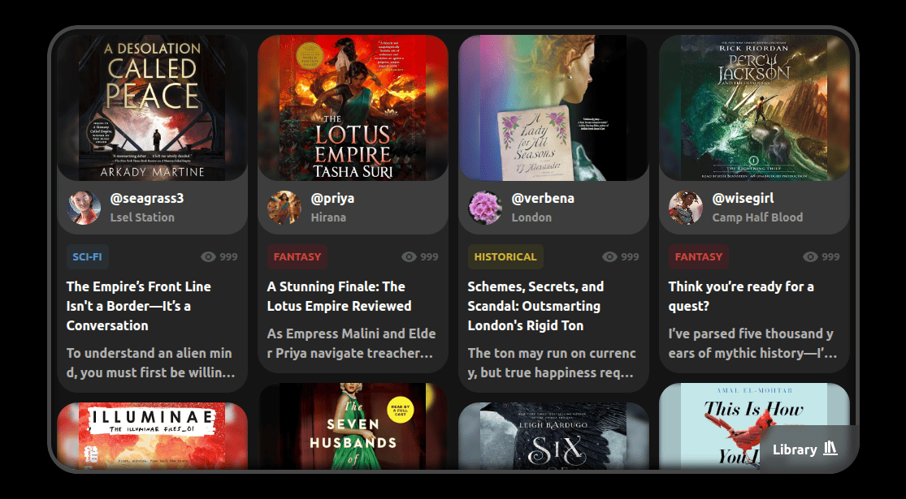
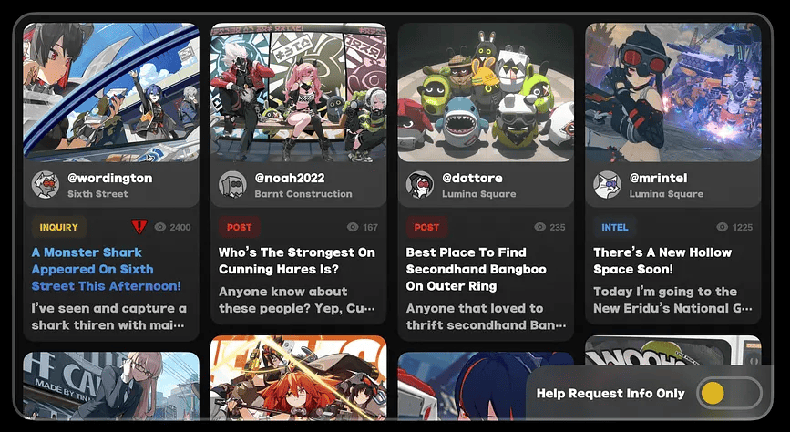

# zzz-masonry-layout
Practicing Masonry Layout with Zenless Zone Zero UI inspired design

## Table of contents

- [Screenshot](#screenshot)
- [Links](#links)
- [What I learned](#what-i-learned)
- [Continued development](#continued-development)
- [Useful resources](#useful-resources)
- [Author](#author)


# Screenshot

## Project Screenshot


## ZZZ UI

Screenshot Source: [Game Quest List Reimagined - Zenless Zone Zero 🕹️](https://dribbble.com/shots/24696782-Game-Quest-List-Reimagined-Zenless-Zone-Zero)

# Links

- Solution URL: [github.com/rizanne-f/zzz-masonry-layout](https://github.com/rizanne-f/zzz-masonry-layout)
- Live Site URL: [rizanne-f.github.io/zzz-masonry-layout/](https://rizanne-f.github.io/zzz-masonry-layout/)

# What I learned

I know how to use pseudo-elements and `position` property now. I previously found these as too advanced and difficult to understand so I avoided them but now I know that I just needed to be flexible and get used to learning new ideas.

I also had a lot of fun playing around with `filter: blur()` to apply an effect to the background.
```css
.blur-background {
  position: absolute;
  inset: 0;
  background-size: cover;
  background-position: center;
  filter: blur(3px);
  opacity: 0.8;
  z-index: 1;
}
```

Overall this was a very fun experiment for the masonry layout. I also used ngrok this time to  check the layout in realtime using my iPhone and I plan to continue using it going forward for mobile-first workflow.

# Continued development

In this project I allowed the items to scroll but I used `overflow: hidden`. In my next coding activities, I want to learn how to customize scroll bars to make it look like it actually belongs to my project design.

I also want to update this code in the future so that each card takes its info from a json file.

# Useful resources

- [Making a Masonry Layout That Works Today](https://css-tricks.com/making-a-masonry-layout-that-works-today/) - The javascript code to make the masonry layout came from this article.
- [How to limit text to n lines with CSS?](https://albertwalicki.com/learn/solutions/how-to-limit-text-to-n-lines) - I rarely have opportunity to use `line-clamp`. This article provided a nice refresher about this CSS property.

# Author

- **LinkedIn** - [Rizanne Fernandez](https://ph.linkedin.com/in/rizanne-fernandez)
- **Twitter** - [@rizanne621](https://www.twitter.com/rizanne621)
- **CodePen** - [@RizanneFernandez](https://codepen.io/RizanneFernandez)